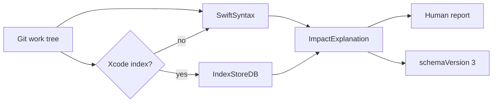
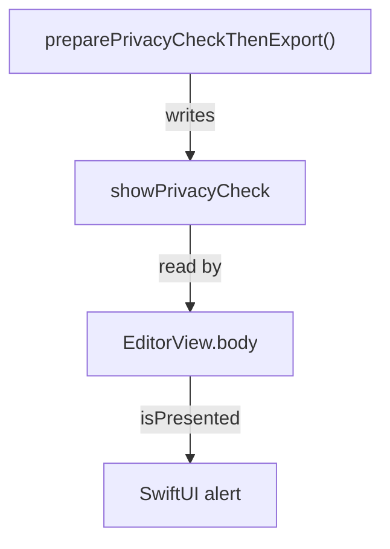

A green build tells you the file compiles. A passing test tells you the cases you wrote still pass.

I kept wanting a third answer: what can this change affect, why, and what should I verify?

That is Afterwave. A local CLI for Swift and iOS. You give it a symbol. It reports the direct neighborhood it can prove. Dependencies, state readers, a bounded set of SwiftUI effects, and a verification path when the evidence actually lines up.

It does not call an AI API. It does not edit the repo. It does not build the app you point it at.

## The question builds and tests don't answer

SwiftUI apps rarely change in one place. A view model writes `showPrivacyCheck`. A view reads it. That read is the `isPresented` binding on an alert. The diff is three lines. The thing you need to click is somewhere else.

I can hold a small app in my head. I cannot hold every reader of every property once the project is real, and I definitely do not want a coding agent guessing that part.

So the report looks like this:

```text
IMPACT SUMMARY
EditorViewModel.preparePrivacyCheckThenExport()

STATE AFFECTED
  EditorViewModel.showPrivacyCheck
    → EditorView.body

UI EFFECTS
  EditorViewModel.showPrivacyCheck
    → presentation binding for SwiftUI alert

VERIFY
  EditorViewModel.preparePrivacyCheckThenExport()
    → writes EditorViewModel.showPrivacyCheck
    → read by EditorView.body
    → SwiftUI alert isPresented binding
```

That is the whole pitch. If I cannot show the chain, I do not get to say the change is fine.


## What I shipped

v0.1.0 is a Swift package. Swift 6.3. SwiftSyntax for the syntax graph. IndexStoreDB, pinned to `swift-6.1.1-RELEASE`, when an Xcode index already exists.

Four commands:

| Command | What you get |
| --- | --- |
| `impact` | Uncommitted Swift changes, or one symbol's direct neighborhood |
| `explain` | That neighborhood as text or JSON |
| `index-status` | Whether a compiler index is there, and whether it is fresh |
| `index-probe` | A raw IndexStoreDB lookup that does not feed the graph |

Install is a bottle, not a compile-on-your-machine surprise:

```bash
brew trust miltonisblurrd/afterwave
brew install miltonisblurrd/afterwave/afterwave
```

`afterwave --version` prints `Afterwave 0.1.0`. Homebrew pours the binary. It does not compile SwiftSyntax on the user's Mac. That was a choice. A source build is for people working on Afterwave, and it takes several minutes.




One analysis. Two renders. The JSON is the contract. The text is for me, reading a terminal.

## Depth 1, on purpose

`explain` does not walk the whole app. It stops at the direct neighborhood.

Method writes property. Property has readers. A reader might be a SwiftUI presentation. That is the hop.



I wanted the transitive version. Everyone wants the transitive version. "Show me everything this feature can touch."

The problem is I would be inventing edges I cannot check. v0.1 fails open: unresolved relationships stay unresolved, and the report says so. An empty `unresolved` array is still not a safety claim. It means I did not record an unresolved edge. It does not mean the change is safe.

Depth 1 is the scope I can defend in a portfolio, in a code review, and in an agent prompt.

## Two evidence sources, one trust object

Syntax analysis always runs. You can explain a symbol with no compiler index at all.

If Xcode has already indexed the project, Afterwave can use that DerivedData store for compiler identity and cross-file relationships. It will not run `xcodebuild` to create one. I did not want a "what does this function affect" tool that kicks off a build.

Trust is part of the result, not a log line you are supposed to notice:

```swift
// from: Sources/AfterwaveCore/CompilerIndexTrust.swift
public struct CompilerIndexTrust: Equatable, Hashable, Sendable, Codable {
    public var used: Bool
    public var availability: CompilerIndexAvailability
    public var projectFreshness: CompilerIndexFreshness
    public var relevantFreshness: CompilerIndexFreshness?
    public var relevantFiles: [String]
    public var evidence: [CompilerIndexEvidence]
    public var warnings: [String]
    public var notes: [String]
}
```

A few rules fell out of using this on real DerivedData:

- Missing index: still exit 0. `used` is false. Read the JSON.
- Stale index: still used, and labeled. Throwing the evidence away felt worse than disclosing it.
- `projectFreshness` and `relevantFreshness` are separate. The project can be stale while the files in this explanation are fresh. Agents are not allowed to learn that by parsing `notes`.
- If DerivedData matches more than one store, Afterwave refuses to guess. Pass `--index-store`.


That last one matters. A confident answer from the wrong index is the failure mode I was trying to avoid.

## The SwiftUI path I would actually verify

SwiftUI coverage in v0.1 is bounded on purpose: `@State`, `@Binding`, `@StateObject` / `@ObservedObject`, `@Published` / `@Observable`, and `isPresented` presentations (`alert`, `sheet`, `fullScreenCover`, `confirmationDialog`). UIKit gets graph identity. It does not get a fake UIKit semantic layer.

A verification recommendation is stricter than "I saw an alert somewhere." The planner only emits one when the neighborhood already resolved the chain: this symbol writes the property, the consumer reads that same property, and the semantic effect says that read is the presentation binding.

```swift
// from: Sources/AfterwaveCore/VerificationPlanner.swift
guard let construct = supportedPresentation(effect),
      let consumer = effect.consumer else {
    return nil
}
guard let write = resolvedWrite(from: neighborhood, property: effect.subject),
      let read = resolvedRead(in: neighborhood, property: effect.subject, consumer: consumer)
else {
    return nil
}
guard write.source == neighborhood.symbol,
      write.target == effect.subject,
      read.target == effect.subject,
      read.source == consumer else {
    return nil
}
```

The path on the recommendation is ordered evidence:

1. writer (`writes`)
2. property (`state`)
3. reader (`reads`)
4. presentation construct (`presentationBinding`)

No paragraph of generated reasoning. If you want prose, you can write it from the path. The tool's job is the path.

The semantic object underneath is small:

```swift
// from: Sources/AfterwaveCore/iOSSemanticAnalyzer.swift
SemanticEvidence(
    kind: "presentationBinding",
    subject: edge.target,
    consumer: edge.source,
    location: "\(filePath):\(occurrence.line)",
    framework: "SwiftUI",
    construct: occurrence.construct.identifier,
    argument: occurrence.construct.argument,
    provenance: displayProvenance(edge.provenance)
)
```

`provenance` is `syntax` or `syntax+compilerIndex`. You can see which source produced the edge.

## Agents get JSON. Humans get the same analysis.

Coding agents in this repo are told to run one command:

```bash
afterwave explain \
  --repo /path/to/MyApp \
  --symbol "EditorViewModel.preparePrivacyCheckThenExport()" \
  --format json
```

`--repo` is the analysis root, a directory inside a Git work tree. It does not have to be the Git root. Nested app targets are valid. Git operations still use the enclosing work tree.

Symbol names match Afterwave's declaration names, not SourceKit USRs. `Type.method()` and `parse(_:)` work. `AfterwaveCLI.parse` does not match `parse(_:)`. Duplicate display names exit 1 and print candidates on stderr. I would rather fail than pick an overload.

The JSON contract is `schemaVersion` 3. That number is not the product version. I can ship `Afterwave 0.1.1` without pretending the agent schema changed.

```json
{
  "schemaVersion": 3,
  "root": { "name": "EditorViewModel.preparePrivacyCheckThenExport()" },
  "stateAffected": [],
  "semanticEffects": [],
  "verificationRecommendations": [],
  "unresolved": [],
  "compilerIndexTrust": {
    "used": false,
    "availability": "unavailable",
    "projectFreshness": "unavailable"
  }
}
```

Fields agents should actually read: `dependencies`, `stateAffected`, `callers`, `semanticEffects`, `verificationRecommendations`, `unresolved`, `compilerIndexTrust`.

Human `explain` text is a render of that same object. Do not scrape it. I have watched enough tools rot because a prompt depended on whitespace.

Exit codes stay boring. 0 means a report was produced, including a missing or stale index. 1 means bad CLI, unknown symbol, ambiguous symbol, or a Git/path failure.

## Shipping the bottle

The v0.1.0 binary is arm64 only. I validated the same executable bytes on three hosts:

| OS | Where | Xcode |
| --- | --- | --- |
| macOS 14.8.9 Sonoma | GitHub Actions `macos-14` | Xcode 15.4, Swift 5.10 |
| macOS 15.7.9 Sequoia | GitHub Actions `macos-15` | Xcode 16.4, Swift 6.1.2 |
| macOS 26.5.2 Tahoe | My machine | Xcode 26.6, Swift 6.3.3 |

On each one: `--version` printed `Afterwave 0.1.0`, syntax-only explain returned schema 3 with `compilerIndexTrust.used` false, and a generated index flipped that to true.

The binary weakly imports `_swift_coroFrameAlloc` from `libswiftCore`. Sonoma and Sequoia do not export that symbol. Launch and analysis still succeeded. Tahoe's runtime does export it. I did not learn that from a README. I learned it by running the bytes.

The bottle tag is `arm64_sonoma`, the oldest OS I validated. Homebrew pours that tag on Sequoia and Tahoe. There is no separate Tahoe bottle. The Sonoma-named archive is a byte-identical copy of the keg already run on all three.


Package.swift says macOS 13. That is the deployment target in the manifest. It is not a claim that I ran Ventura.

## What I'd do differently

Depth 1 will annoy someone in week one. They will ask for the whole feature. I would still start here. A second hop is a product change, and it needs its own trust story.

UIKit is thin. Call graph and identity, yes. UIKit-specific effects, no. I did not want a paragraph that pretends otherwise.

IndexStoreDB is pinned behind the toolchain I build with. Swift 6.1.1 index store, Swift 6.3 compiler. It works on the development Mac and on the CI hosts I ran. That is not a matrix I would bet a company rollout on without more Xcode versions.

Query databases land in `TMPDIR/afterwave-indexdb-<UUID>/` and are not deleted. Fine for a local tool. I would clean that up before I called this a daemon.

## What I learned

- If the tool cannot prove an edge, leave it unresolved. A shorter true report beats a long confident one.
- Put trust in structured fields. `used`, freshness, relevant files. Notes are for humans skimming, not for agents inferring.
- Keep the human render and the JSON on one object. The day those diverge, one of them is lying.
- Do not build the user's project to answer a question about a symbol. Use the index they already have, or say you did not.
- Ship the bytes you tested. One arm64 bottle, three OS versions, same SHA.

## If you want to try it

Apple Silicon. Git on the path. The project has to live in a work tree.

```bash
brew trust miltonisblurrd/afterwave
brew install miltonisblurrd/afterwave/afterwave
afterwave explain --repo . --symbol "YourType.yourMethod()" --format json
```

Source is Apache-2.0: [github.com/miltonisblurrd/Afterwave](https://github.com/miltonisblurrd/Afterwave).

I built this because I wanted the blast radius in the terminal before I trusted a diff. If that is the kind of tool you want next to your editor, the command above is the whole demo.
